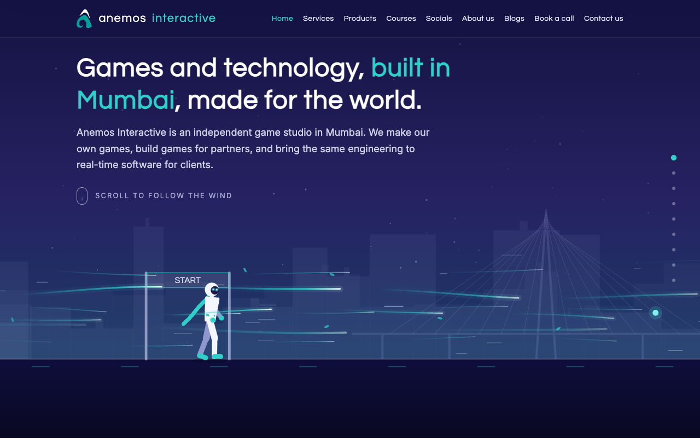
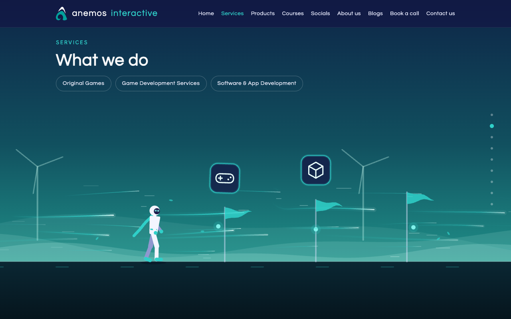
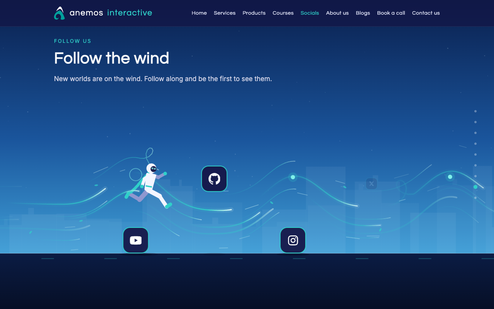
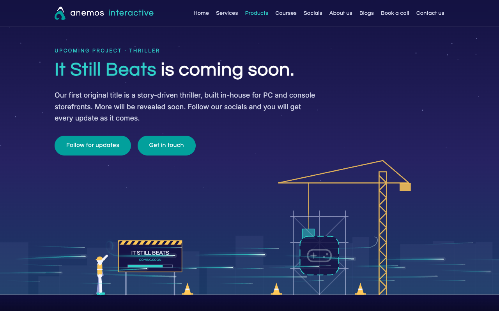
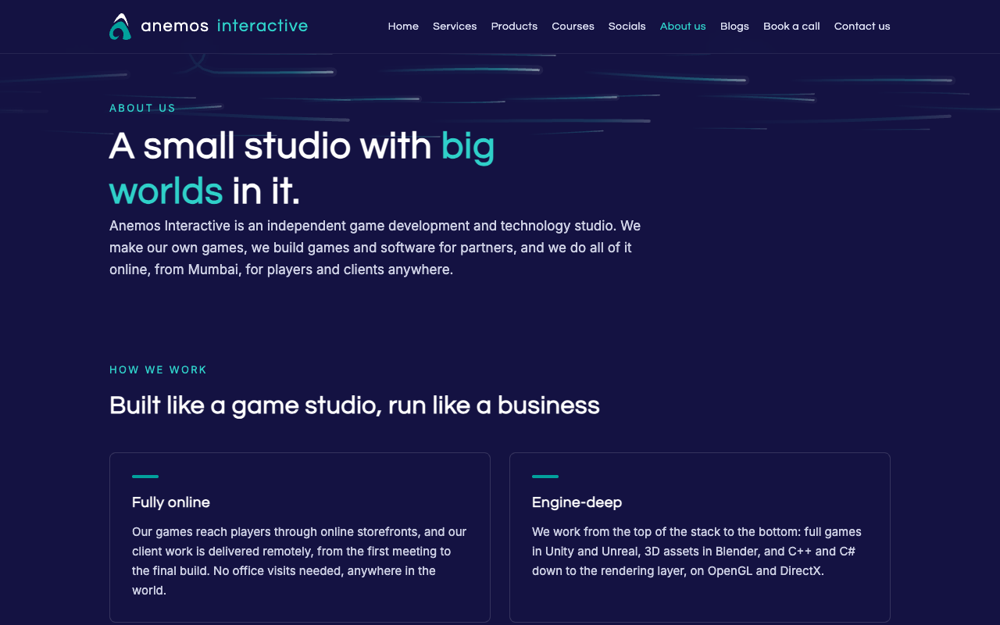
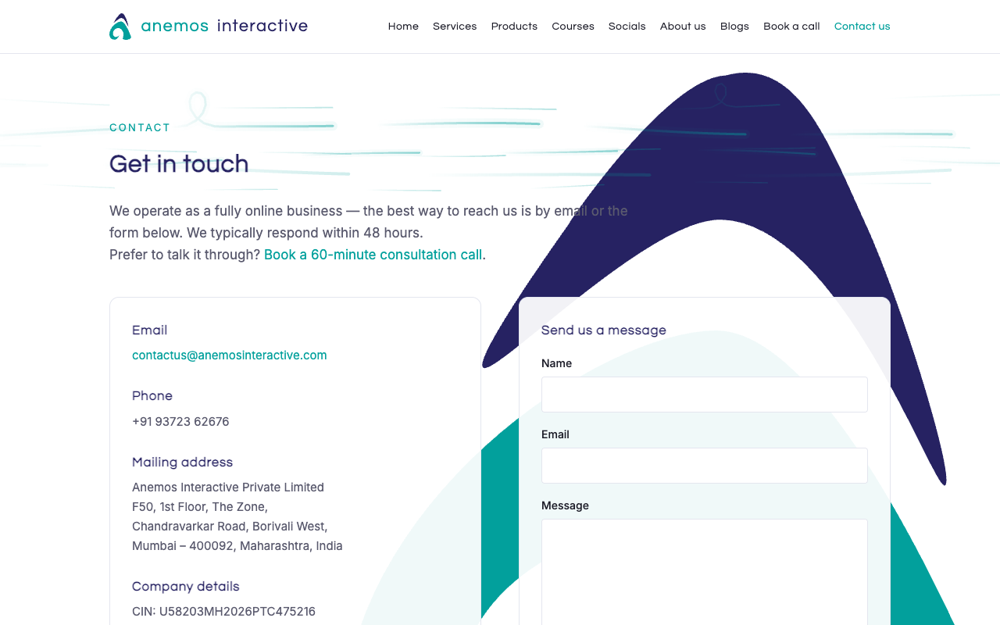
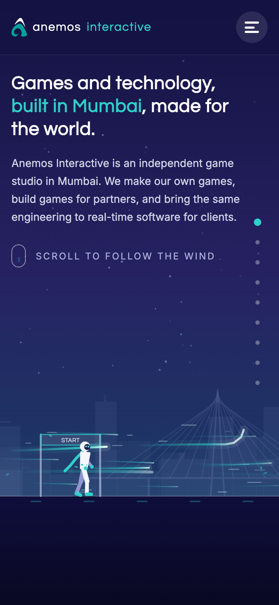

# Anemos Interactive — the website

This is the source of **[anemosinteractive.com](https://anemosinteractive.com)**, the website of Anemos Interactive Private Limited, a game and technology studio.



## The idea

We didn't want a brochure. We make games, so the site should feel like one.

The home page is a single run. A runner stands at a start line; as you scroll, the wind pushes them along an obstacle course, and each stop on the course is a section of the site: what we do, the game we're building, courses, where to follow us, who we are. The copy for each stop blows in as the runner reaches it. At the end of a section there's a hoop; run through it and the wind carries you to another page. Every page you land on arrives on the same gust.



Everything on the course is drawn live on a canvas: the runner, the wind lines, the hoops, the start gate, the windmills, the construction site, the social-media tiles the runner has to hop over. The words are ordinary HTML, so search engines and screen readers read them like any other page.

## How it came together

It started as one line: *"a runner on an obstacle course, guided by wind, and the text appears as you scroll."* The first version was a stick figure on a flat line and a wall of text. From there it was mostly iteration and feedback:

- **Speed.** The first run was far too quick — one flick of the wheel and you'd skipped three sections. The scroll distance was stretched several times until the pace felt like walking through it, and a row of dots on the right lets you jump or drag to any stop.
- **Screens.** It had to work from a 4K monitor to a 300-pixel-wide phone, folded and unfolded, upright and sideways. Sideways phones get their own layout: copy on the left, the run on the right.
- **Slow connections.** People in low-bandwidth areas reported the page jumping to the end before it had loaded. The fix was a small loading screen that waits until most of the site has arrived (and never shows on a return visit).
- **Browsers.** Checked in Chromium, Firefox and Safari engines, and against Samsung Internet's taller toolbars, which cut off the bottom of a full-height page if you let them.
- **Copy.** Friends and a few people in the industry read it and told us where it was vague, where it overclaimed, and where it sounded like every other studio. It was rewritten until it didn't.
- **Details that people noticed.** The purple that looked off, the logo touching the edge on small phones, the social tiles that made the runner jump too often (now they alternate: hop one, duck under the next). Most of what's good about the site came from someone saying "that looks wrong".



## What's here

| Page | What it is |
|---|---|
| Home | The run: services, products, courses, socials, about, and a hoop to the contact page |
| Products | *It Still Beats*, our first game, and a construction worker waving from the site |
| Blogs | Posts from the team, written in a small admin of our own |
| About us | How we work and who the founders are |
| Book a call | A calendar for a free consultation call, in your local time |
| Contact | A form, the company details and the mark from our business card behind the page |
| Privacy, Terms, 404 | The boring pages, done properly; the 404 page is where the wind took you by mistake |





## How it's built

- **Pages:** plain HTML, CSS and JavaScript. No framework, no build step. The run is Canvas 2D in [`public/wind.js`](public/wind.js); the layout is in [`public/style.css`](public/style.css).
- **Hosting:** Cloudflare Workers, serving `public/` as static assets. [`wrangler.jsonc`](wrangler.jsonc) describes the three environments (live, test, experiment), each with its own hostnames.
- **Blog:** a Cloudflare Worker in [`src/`](src/) renders `/blogs` and the posts from a D1 database, keeps images in R2, publishes an RSS feed and adds every post to the sitemap. The admin lives on its own hostname behind Cloudflare Access, so only the team's Microsoft 365 accounts can sign in. Posts are written in Markdown with a small formatting bar; whatever is typed is sanitised before it reaches the page.
- **Forms and bookings:** the contact form posts to Web3Forms; the booking page embeds Microsoft Bookings.
- **Analytics:** Google Analytics 4 behind a consent line — nothing is stored on a visitor's device until they say yes.
- **Checks:** every change is run through a 14-size resolution matrix, an HTML/accessibility audit, Lighthouse, and the WebKit and Gecko engines before it goes to the test site, and again before it goes live.



## Running it

The static site needs nothing but a web server:

```sh
cd public && python3 -m http.server 8765
# open http://localhost:8765
```

The blog needs a Cloudflare account with the D1 database and R2 bucket from `wrangler.jsonc`:

```sh
npm install
npx wrangler login
npx wrangler d1 execute anemos-blog-experiment --env experiment --remote --file=schema.sql   # once
npx wrangler dev --env experiment
```

Deploying is one command per environment: `npx wrangler deploy --env experiment`, `--env test`, or plain `npx wrangler deploy` for the live site. A short script stamps the stylesheet and script URLs on every deploy so no browser or edge cache serves a stale copy.

<p align="center"></p>

## Credits

Designed and built by **Ronak Koshy Jacob**, founder and managing director of Anemos Interactive. Brand and visual identity by **Latika Ganesh Salian**, co-founder and creative director.

© 2026 Anemos Interactive Private Limited. All rights reserved. The code is published so people can see how the site works; the Anemos Interactive name, logo, artwork and copy are not licensed for reuse.
