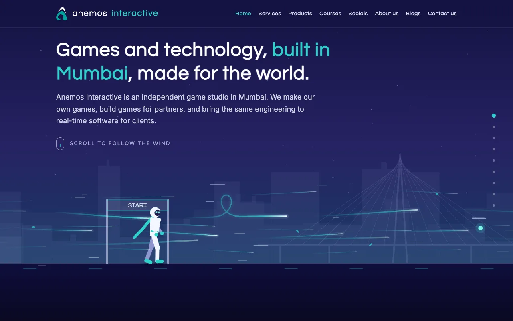
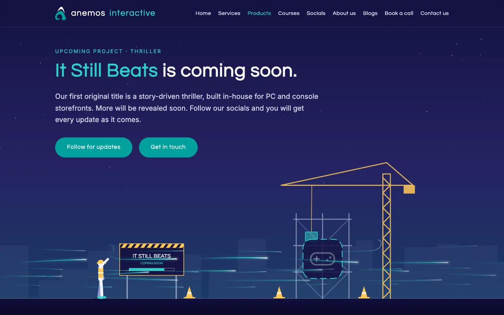
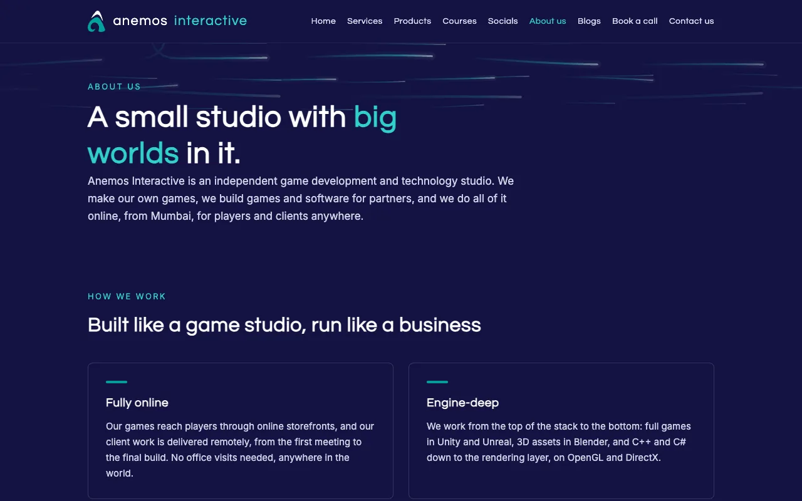
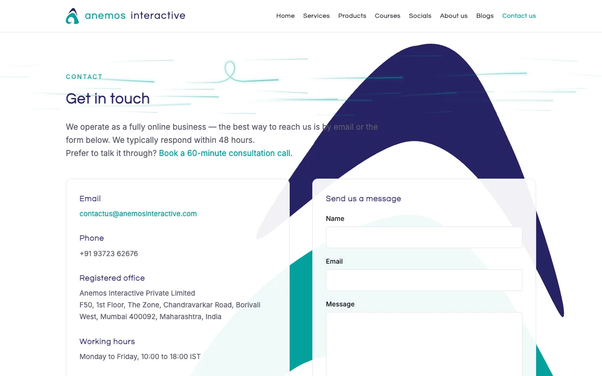
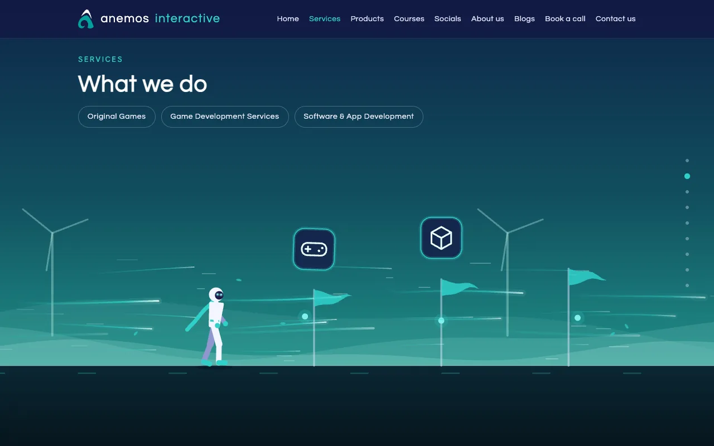
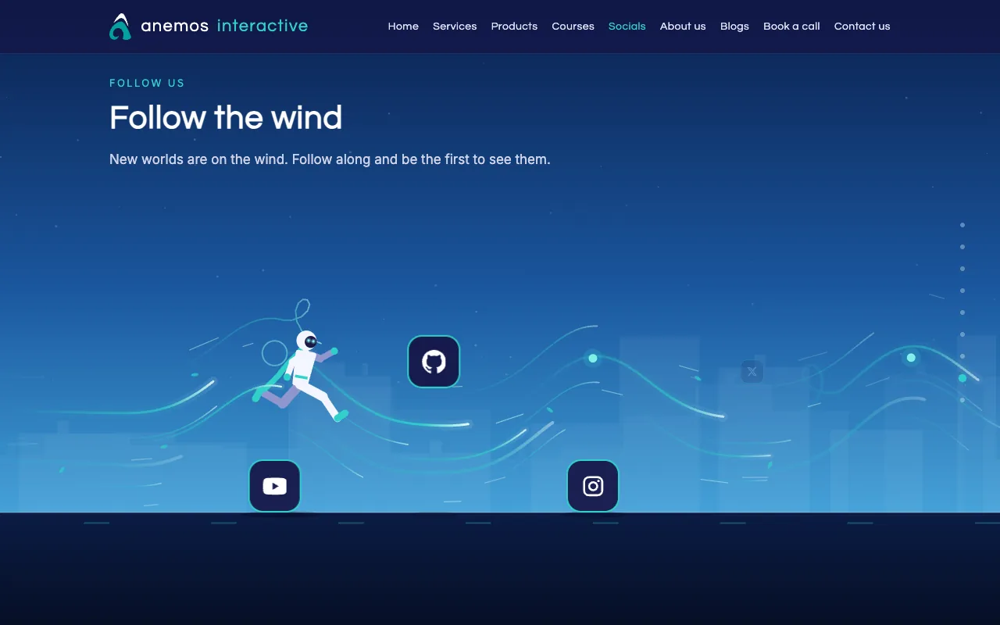
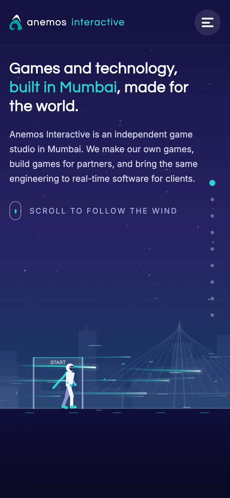

# Anemos Interactive — the website

The source of **[anemosinteractive.com](https://anemosinteractive.com)**, the website of Anemos Interactive, a game and technology studio.

I'm Ronak, and I built this site. I've written this README for students and anyone learning web development. It covers what the code does, and also how the site went from one sentence to a live website: what I tried, what I threw away, how I chose each tool, and how I check everything before it goes out. Read it alongside the code; most files open with a comment that says what they are for.

> **About this copy.** This repository is a public copy of the site's source. The code, pages, styles and animation are as deployed. The settings tied to our own accounts are placeholders: the hosting configuration uses `example.com`, database IDs say `REPLACE_WITH_…`, and the analytics and contact-form keys are dummies. The pages themselves are ours, with our name, address, legal pages and links to anemosinteractive.com.
>
> **This repository is public for learning and to showcase our work. It is not open source.** You're welcome to read it and to run it on your own computer to see how it works. Everything in it belongs to Anemos Interactive, and it isn't licensed for reuse; see [Credits and copyright](#credits-and-copyright).



## Contents

- [What you're looking at](#what-youre-looking-at)
- [How I made it: the process](#how-i-made-it-the-process)
- [The stack, and why](#the-stack-and-why)
- [The brainstorm, honestly](#the-brainstorm-honestly)
- [How the run works](#how-the-run-works)
- [How the blog works](#how-the-blog-works)
- [Security, in plain terms](#security-in-plain-terms)
- [How I test it](#how-i-test-it)
- [Hosting on Cloudflare](#hosting-on-cloudflare)
- [Run it on your machine](#run-it-on-your-machine)
- [Setting up the services yourself](#setting-up-the-services-yourself)
- [Folder map](#folder-map)
- [What I'd tell myself at the start](#what-id-tell-myself-at-the-start)
- [Credits and copyright](#credits-and-copyright)

## What you're looking at

- **A home page that plays like a small game.** You scroll, and a runner crosses an obstacle course. Each stop on the course is a section of the site, and the words blow in as the runner arrives.
- **Eleven more pages in plain HTML:** products, about, contact, a booking calendar, pricing, the legal pages and a 404.
- **A small blog with its own admin,** running on Cloudflare Workers.

| Part | Size |
|---|---|
| The animation, [`public/wind.js`](public/wind.js) | about 1,600 lines of plain JavaScript |
| The styles, [`public/style.css`](public/style.css) | about 1,400 lines of plain CSS |
| The blog and admin, [`src/`](src/) | about 1,000 lines of JavaScript |
| Dependencies | one at runtime: [`marked`](https://github.com/markedjs/marked), the Markdown parser. [Wrangler](https://developers.cloudflare.com/workers/wrangler/), Cloudflare's command-line tool, runs the site locally and deploys it. |
| Build step | one small script that adds a content fingerprint (`?v=…`) to the CSS and JS addresses |

There is no framework, no bundler and no build pipeline. The pages are files in a folder.

| Products | About us | Contact |
|---|---|---|
|  |  |  |

## How I made it: the process

If you take one thing from this README, take this section. None of the steps needs special talent; they need patience and other people's eyes.

1. **Start with one sentence.** Mine was: *"a runner on an obstacle course, guided by wind, and the text appears as you scroll."* Every later decision was checked against it. When an idea didn't serve that sentence, it went.
2. **Build the ugliest version that works.** The first version was a stick figure on a flat line and a wall of text. It took an afternoon and proved the one thing that mattered: scrolling can drive a scene.
3. **Write down *why* before you pick a tool.** For every choice (framework or not, canvas or WebGL, which host) I wrote one line on why. The [stack table](#the-stack-and-why) is those lines. If you can't write the line, you don't need the tool yet.
4. **Show it to people early and write down what they say.** Most of what is good about the site came from someone saying "that looks wrong":
   - **Pace.** The first run was far too quick: one flick of the mouse wheel and you'd skipped three sections. I stretched the scroll distance again and again, to about thirty-four screen heights for one screen of picture, until it felt like walking. A column of dots on the right lets you jump between stops. I tried a "speed bump" that slowed you down when you rushed; it felt like fighting the page, so it went.
   - **Worlds.** Each section got its own weather and scenery, so you know where you are without reading: a city skyline, windmills, a building site, a lecture hall, a sky full of gusts.
   - **Screens.** It had to work from a 4K monitor down to a 300-pixel-wide phone, folded and unfolded, upright and on its side. Phones on their side get a different layout, with the words on the left and the run on the right.
   - **Slow connections.** People on slow networks told me the page jumped to the end before it had loaded. The fix was a loading screen that appears only when needed, waits for about 60% of the site by weight, and never shows on a return visit.
   - **Copy.** Friends and people in the industry read every line and told me where it was vague or overclaimed.
5. **Keep the words real.** Everything you can read is HTML laid over the canvas, never drawn into it. Search engines, screen readers and people with JavaScript off all get the full text.
6. **Add the dynamic part only where it's needed.** The site was static for weeks. The blog arrived when people needed to post without touching code, and only the blog runs on a server.
7. **Test like a pessimist.** Fourteen screen sizes, three browser engines, accessibility and validity checks, before every release. See [How I test it](#how-i-test-it).
8. **Ship to a test copy first.** There is a test site with its own database. Every change lives there until it passes the checks, and only then goes live.
9. **Review security before strangers can type into it, and again before you publish your code.** The admin is the only place the site accepts input. It was reviewed in October and audited again before this copy went public, and the security problems those audits found were fixed first. See [Security, in plain terms](#security-in-plain-terms).

The timeline, roughly: a plain static site in late September 2026; the run, the worlds and the work for every screen size in the first ten days of October; live on 10 October; the loading screen, booking page, analytics and legal pages in the two days after; the blog and its admin after that; security hardening and the pricing and policy pages later in October.



## The stack, and why

| Choice | Why |
|---|---|
| **Plain HTML, CSS and JavaScript**, no framework or bundler | A dozen pages and one big animation. A framework would add a build step, a dependency tree and kilobytes of runtime for no visible benefit, and plain files are the easiest thing to keep running for years. |
| **Canvas 2D** for the run, not WebGL or a game-engine export | Canvas 2D works in every browser from the last eight years or so, needs no GPU features, and comfortably draws a few hundred lines and shapes per frame on a cheap phone. |
| **HTML for the words**, drawn over the canvas | Nothing you can read exists only as pixels. |
| **Two self-hosted fonts** (Questrial and Inter), with Google Fonts as a fallback | No third-party request on first paint, no layout shift, and nothing for the privacy policy to explain unless the fallback is used. |
| **Cloudflare Workers** to host, **D1** for the blog's database, **R2** for images, **Access** for the admin sign-in | One provider, one deploy command, and all of it fits in the free tiers. |
| **Microsoft 365** for email, the booking calendar and staff sign-in | We already used it; it brings bookings, calendars and multi-factor sign-in without building any of them. |
| **Web3Forms** for the contact form | A static site can't receive a form post. Web3Forms turns the post into an email, with a honeypot field against bots. |
| **Google Analytics 4** with Consent Mode | Visitor numbers, countries, devices and which part of the run people reach, without setting a cookie until someone agrees. |
| **Markdown** for blog posts | Plain text any editor can open, easy to render safely, and it keeps authors writing instead of styling. |

## The brainstorm, honestly

Every "why" above has a longer, less flattering story.

**"Should we use a framework?"** The first ten minutes of any website project. We listed what the site had to do: show a few pages and make a small person run. React, Vue and friends are superb at managing state across hundreds of components; we had one component, and it was a canvas. A day setting up a build pipeline to ship a runtime larger than the whole site didn't add up. So: no framework.

**"Canvas, WebGL, or just export a video?"** The video idea lasted until someone asked how you make a video respond to fourteen screen sizes and a scroll wheel. WebGL was tempting (we're a game studio, it would have been on brand), but it means shaders, GPU quirks on cheap phones and a blank rectangle on old devices. Canvas 2D draws lines and circles. The runner is lines and circles. Sold.

**"The text has to be real text."** Less a debate than a rule I kept re-learning. When you're drawing a world, it's very easy to draw the words into it too. Then Google can't read them, screen readers can't read them, and the one visitor with JavaScript off gets a beautiful empty sky. The canvas only draws things that don't need reading, like a sign that says START.

**"Netlify was fine. Why did we move?"** It was fine. On the plan we were using, though, our preview links sat behind a login, which defeats the point of a preview link. Meanwhile the domain's DNS was already at Cloudflare, Cloudflare hosts static files for free with no bandwidth charge, and the deploy is one command. The move took an afternoon.

**"How does a static site receive a form?"** It doesn't; that's what static means. The options were a backend for one form, a mail API plus our own form handling, or a service whose whole job is turning a form post into an email. We picked the last one.

**"Booking calls: build or buy?"** I briefly sketched a calendar widget with time-zone handling, then remembered Microsoft 365 includes Bookings, which already does time zones, buffers, confirmations and reminders. The sketch was deleted with great dignity.

**"Analytics without being creepy."** Google Analytics 4's consent mode sends anonymous, cookieless pings until someone says yes. One short line at the bottom of the page asks. It is not a banner.

**"The blog: WordPress? Ghost? A folder of Markdown files?"** WordPress would have meant a second server, PHP, plugins and a lifetime of updates for a blog that posts a few times a month. Markdown files in the repo would have meant a code change every time someone fixed a typo. The middle path: posts in a small database at the edge, images in a bucket next to it, rendered by the same Worker that serves the site. There's nothing to patch, and I understand every line.

**"Who gets to post, and how do we know it's them?"** The first plan was emailing one-time codes. Then I noticed I'd be building a login system (codes, expiry, rate limits, the lot) to prove something Microsoft already proves every morning when staff sign in to their email. So the admin sits behind Cloudflare Access, using the company's Microsoft accounts as the sign-in. I built nothing and got multi-factor sign-in for free.

**"Rich text editor or Markdown?"** Rich text editors are either enormous or buggy, and usually both. Markdown is a text box. I added a bar of buttons so nobody has to remember that two asterisks mean bold, and taught the box to continue a list when you press Enter.

**"What about giant images?"** The first test post had a 4,000-pixel cover that took over the page. Now the editor shrinks big images before they upload, and posts show every image at the same width.

**"How do search engines find a new post?"** IndexNow is a single request that says "this address changed". Bing and the engines that share its index come within hours. It took five minutes to add.



## How the run works

All of it lives in [`public/wind.js`](public/wind.js), with the layout in [`public/style.css`](public/style.css). If you want to build something similar, these are the ideas that matter.

- **Scroll drives the scene; the scene doesn't scroll.** The page is very tall, and the stage holding the canvas is `position: sticky`, so it stays put while you scroll. The script turns your scroll position into a distance along the course.
- **Measure the world in runner heights, not pixels.** Every object's position and size is in "runner heights". That is why the scene looks the same on a phone and on a cinema screen: the world scales with the runner.
- **Sections are HTML panels.** Each stop is a normal block of HTML. As the runner gets close, the panel fades in and its words are split into spans and revealed one after another, with a small delay each.
- **One animation loop, only when needed.** Drawing happens in a `requestAnimationFrame` loop that stops when nothing is visible. The canvas is drawn at no more than twice the screen's pixel density, which keeps cheap phones smooth.
- **Hoops change the world, and the last one changes the page.** A hoop sits between each pair of sections, and the scenery changes on its far side. The last hoop carries you to the contact page: it plays a short wipe, and the contact page opens with the same wipe clearing. A flag in `sessionStorage` tells it you arrived on the wind.
- **Links stay real links.** The social tiles the runner hops over are ordinary `<a>` elements positioned over the canvas, so they're clickable and reachable by keyboard.
- **Respect reduced motion.** If the visitor's system asks for reduced motion, the run is switched off and the sections show as a plain page.
- **Old browsers degrade quietly.** Newer APIs (`ResizeObserver`, `IntersectionObserver`) are used when present, with simple fallbacks when they're not.

## How the blog works

The blog is the only dynamic part of the site. It runs in a Cloudflare Worker next to the static files.

```
visitor ──► Cloudflare edge ──┬─► static files in public/      (most requests: no code runs)
                              │
                              └─► Worker  src/worker.js
                                    ├─ public hostname: /blogs, /blogs/<post>, RSS feed,
                                    │                   sitemap, images under /media/
                                    └─ admin hostname:  post list, editor, JSON API
                                                          │
                                         D1 (posts, authors, media, audit)  +  R2 (images)
```

| Part | What it uses | Why |
|---|---|---|
| Pages and API | A Cloudflare Worker | No server to run or patch; it scales to zero and runs close to the visitor. |
| Posts | Cloudflare D1 (SQLite at the edge), see [`schema.sql`](schema.sql) | A real database with plain SQL, free at this size. |
| Images | Cloudflare R2 (object storage) | No charge for bandwidth, which is the cost that bites image-heavy blogs elsewhere. |
| Writing | Markdown, parsed by `marked` | Plain, portable, and simple to render safely. |
| Safety | An allow-list built on Cloudflare's `HTMLRewriter` ([`src/markdown.js`](src/markdown.js)) | Every tag and attribute a post may contain is on a short list; anything else is dropped. |
| Sign-in | Cloudflare Access in front of the admin hostname ([`src/auth.js`](src/auth.js)) | The identity provider does the hard part; the Worker only verifies the result. |

Some details worth reading in the code:

- **Posts are rendered once, when saved.** The Markdown and the cleaned HTML are both stored, so reading a post is one database query and no parsing.
- **The sitemap and RSS feed are generated** from the published posts on each request ([`src/public.js`](src/public.js)).
- **Images get a lighter WebP copy** when the author's browser can make one. Browsers that accept WebP get the copy and everything else gets the original, decided per request by the `Accept` header.
- **Roles are simple.** Accounts listed in `ADMIN_EMAILS` can edit every post; everyone else edits only their own.
- **Each environment is separate.** The test site has its own database and bucket, so nothing written while testing can reach the live site.

## Security, in plain terms

The admin is the only part of the site that accepts input, so most of this is about it. Each item is an idea you can apply in your own projects.

- **Don't build a login if you don't have to.** The admin hostname sits behind Cloudflare Access. The only way in is a company account from the identity provider, with its multi-factor sign-in. There's no password database of ours to leak.
- **Check twice.** Access lets a request through and attaches a signed token (a JWT). The Worker doesn't take that on trust: it fetches Cloudflare's public keys, verifies the signature, the audience, the issuer and the expiry, then checks the email domain and, optionally, the author group itself ([`src/auth.js`](src/auth.js)). Any failure means no entry.
- **Allow-list, don't block-list.** The post sanitiser ([`src/markdown.js`](src/markdown.js)) lists what *is* allowed. Scripts, styles, frames and forms are dropped with their contents. So is every element whose contents the browser reads as plain text, such as `title`, `xmp` and `noembed`: unwrap one of those and its text turns back into markup, which is exactly how sanitisers get bypassed. Links keep only safe schemes, and a site link must start with a single `/`. Links are checked the way a browser will read them, after decoding character codes like `&#47;` and removing tabs and line breaks, because that's how `/<tab>/evil.example` would otherwise sneak past. A repeated attribute keeps one copy, and comments are removed. If a post ends in the middle of a tag, the unfinished tag becomes plain text: the parser would pass it straight through, and the browser would finish it using whatever the page puts next.
- **Trust bytes, not names.** An upload is accepted only if its first bytes say PNG, JPEG, WebP or GIF, whatever the file is called. Uploads are capped at 8 MB, stored under random names and served as exactly the type found. SVG is refused because it can carry scripts.
- **Make cross-site requests fail.** Every API call must carry a custom header, and the site grants no cross-origin permissions, so another website can't make a signed-in browser call the API.
- **Send protective headers** ([`src/worker.js`](src/worker.js)): HTTPS only, no content sniffing, no framing by other sites, a referrer policy, a permissions policy, and a Content Security Policy listing the only places scripts, fonts, images and frames may come from. Static files that skip the Worker get the first four from [`public/_headers`](public/_headers).
- **Never vouch for a script you didn't write.** Inline scripts are allowed in two ways. Our own static pages get a *nonce*, a random value made fresh for every response, stamped onto their scripts. Pages built around blog posts get no stamping at all: their three fixed scripts ([`src/inline.js`](src/inline.js)) are allowed by their SHA-256 *hash*. An inline script that somehow got into a post would have neither, and the browser refuses it. Script files may only come from this site, Google Analytics' loader and Cloudflare's beacon. Stamping a nonce onto every script on a page that contains user content would undo the whole point.
- **Keep a record.** Every create, publish, unpublish, delete and upload is written to an audit table with who did it and when.
- **Keep secrets out of the repository.** Nothing in this repo is a secret. The keys a site like this needs are either public by design or kept out of git; see [Setting up the services yourself](#setting-up-the-services-yourself).
- **Say where to report problems:** [`public/.well-known/security.txt`](public/.well-known/security.txt), following RFC 9116.

Trade-offs, stated so nobody has to discover them: the sanitiser is a small allow-list written for this site rather than a library; the Content Security Policy allows inline styles; the API has no rate limit beyond the sign-in.

## How I test it

Releases go to the test site first, and are checked there like this:

- **Fourteen screen sizes**, from a 300×600 phone up to a 3840×2160 monitor, with tablets both ways and the common laptop sizes in between. Each page is checked for sideways overflow, a working menu, correct links and no console errors.
- **Three engines:** Chromium, Firefox and WebKit (Safari's engine).
- **[html-validate](https://html-validate.org/)** for valid markup, **[axe-core](https://github.com/dequelabs/axe-core)** for accessibility, and **[Lighthouse](https://developer.chrome.com/docs/lighthouse)** for performance, best practice and search.
- **The response headers and Content Security Policy**, so a tightened policy can't quietly break the booking calendar or the analytics.

The scripts aren't in this repository, but the idea is simple enough to build yourself with a browser-automation library such as [Puppeteer](https://pptr.dev/). This is the core idea of the size check:

```js
import puppeteer from 'puppeteer';

const sizes = [[360, 740], [390, 844], [768, 1024], [1280, 800], [1920, 1080]];
const browser = await puppeteer.launch();
for (const [width, height] of sizes) {
  const page = await browser.newPage();
  await page.setViewport({ width, height });
  await page.goto('http://localhost:8787/', { waitUntil: 'networkidle0' });
  const overflow = await page.evaluate(() => document.documentElement.scrollWidth - document.documentElement.clientWidth);
  console.log(`${width}x${height}`, overflow > 0 ? `overflows by ${overflow}px` : 'ok');
  await page.close();
}
await browser.close();
```

## Hosting on Cloudflare

- **One Worker, two environments.** [`wrangler.jsonc`](wrangler.jsonc) describes a live Worker and a test Worker, each with its own domain, admin hostname, database and bucket.
- **Static files first.** Everything in `public/` is served by Cloudflare's edge without running any code; those requests are free and unlimited. The Worker runs only for the paths listed in `run_worker_first`: the blog, the images, the sitemap and the HTML pages, so it can add the Content Security Policy to them.
- **Caching without stale files.** [`public/_headers`](public/_headers) sets how long browsers keep each file. Before every deploy, [`scripts/stamp.mjs`](scripts/stamp.mjs) works out a short content hash for each CSS and JS file, and the Worker adds it to their URLs (`style.css?v=…`), so a changed file shows on the next visit instead of after the cache expires.
- **Free-tier limits** worth knowing: 100,000 Worker requests a day (files served straight from `public/` without the Worker don't count, but the HTML pages here do run it); D1 at five million reads a day; R2 at ten gigabytes with no bandwidth charge; Access free for up to fifty users.

## Run it on your machine

You need [Node.js](https://nodejs.org/) on a supported long-term-support line (22 or 24 at the time of writing), on its latest patch release. Lines that have reached end of life (20 and below) no longer get security fixes, so don't use them.

**Just the pages.** Any static web server will do. The blog won't work this way, but everything else does:

```sh
cd public && python3 -m http.server 8000
# open http://localhost:8000
```

**The whole site, blog included.** Wrangler runs the Worker, the database and the image bucket locally; no Cloudflare account is needed for this. `npx` downloads Wrangler the first time you use it.

```sh
npm install

# A local secret for the stand-in admin sign-in, and the switch that allows it on this machine.
# .dev.vars is git-ignored; never commit it.
printf 'DEV_KEY=%s\nDEV_SIGNIN=1\n' "$(openssl rand -hex 24)" > .dev.vars

# Create the tables in the local database.
npx wrangler d1 execute my-site-blog --local --file=schema.sql

# The public site, at http://localhost:8787
npx wrangler dev
```

The Worker decides between the public site and the admin by hostname, so to open the admin locally, stop the first command and run it with the admin hostname instead:

```sh
npx wrangler dev --local-upstream admin.example.com
# open http://localhost:8787/admin/login
```

Sign in with the `DEV_KEY` from `.dev.vars` and any email ending in `@example.com` (the `ALLOWED_DOMAIN`). The stand-in sign-in only works where `DEV_SIGNIN=1` is set, which is only ever in `.dev.vars`. Publish a post, stop the server, start `npx wrangler dev` again, and the post is on `/blogs`. Both runs share the same local data; run one at a time.

## Setting up the services yourself

This section is a guide for your own projects. The code here isn't licensed for reuse, and the commands below aren't meant to be run against this repository. But the services behind it are ones you can use for anything you build, and setting them up is half the learning. These are the accounts and keys a site like this needs, and how to get each one. The table also shows where each value sits in this project, so you can see how it's used, and which values are safe to commit and which are secrets.

| Value | Where it goes in this project | Secret? |
|---|---|---|
| Web3Forms access key | `public/contact.html`, the `access_key` field | No. It sits in public HTML by design and can only send mail to its own inbox. |
| Google Analytics measurement ID (`G-…`) | `public/analytics.js`, and the cookie name in `public/privacy.html` | No. It's in every page's source. |
| D1 database IDs, R2 bucket names | `wrangler.jsonc` | No, but they belong to your account. |
| Cloudflare Access team domain and AUD tag | `wrangler.jsonc` | No. They identify the sign-in; they don't grant it. |
| IndexNow key | `wrangler.jsonc` and `public/<key>.txt` | No. Search engines fetch it from your site. |
| `DEV_KEY` | `.dev.vars` on your own machine only | **Yes.** Never commit it, and never use it online (see below). |
| Cloudflare API tokens, identity-provider client secrets | Only in Cloudflare (Wrangler stores its own login on your machine) | **Yes.** Never in the repo. |

**Web3Forms (contact form)**
1. Go to [web3forms.com](https://web3forms.com), enter the email address that should receive messages, and they email you an access key.
2. Put it in your form's hidden `access_key` field. (In this project, that's in `public/contact.html`.)
3. If your site has a Content Security Policy, allow the form service in `form-action` and `connect-src`, or the browser will block the form. (This project's policy is in `src/worker.js`.)

**Google Analytics 4 (optional)**
1. In [Google Analytics](https://analytics.google.com), create a property, then a **Web** data stream for your domain.
2. Copy its measurement ID (`G-` followed by ten characters) into your analytics snippet. (In this project, that's `public/analytics.js`.)
3. Name the cookies it sets (`_ga` and `_ga_<your ID>`) in your own privacy policy.

**Cloudflare (hosting, database, images)**
1. Create a free Cloudflare account and [add your domain](https://developers.cloudflare.com/fundamentals/manage-domains/add-site/) to it.
2. Sign Wrangler in: `npx wrangler login`.
3. Create your databases and copy each printed `database_id` into your project's Wrangler configuration:
   ```sh
   npx wrangler d1 create my-blog
   npx wrangler d1 create my-blog-test
   ```
4. Create the tables in each from your own schema file:
   ```sh
   npx wrangler d1 execute my-blog --remote --file=schema.sql
   npx wrangler d1 execute my-blog-test --env test --remote --file=schema.sql
   ```
5. Enable R2 once in the Cloudflare dashboard (Cloudflare asks for a payment method even for the free allowance), then create the buckets:
   ```sh
   npx wrangler r2 bucket create my-media
   npx wrangler r2 bucket create my-media-test
   ```
6. Put your own domain in your project's Wrangler configuration. Cloudflare creates the DNS records and certificates for those hostnames when you deploy.
7. Deploy: `npx wrangler deploy --env test` for a test environment, `npx wrangler deploy` for the live one.

**Signing in to the admin**

**Never put the admin online without Cloudflare Access.** The stand-in sign-in (`DEV_KEY`) is for your own machine only. It's one shared key with no rate limit, and whoever has it can sign in as *any* address at your domain, including an editor. Online, put the admin behind [Cloudflare Access](https://developers.cloudflare.com/cloudflare-one/applications/configure-apps/self-hosted-public-app/):

1. In the Cloudflare **Zero Trust** dashboard, pick a team name. Your team domain is `<team>.cloudflareaccess.com`.
2. Add a login method. **One-time PIN** (a code by email) needs no setup; Microsoft Entra ID, Google and GitHub are also available.
3. Add a **self-hosted application** for your admin hostname (`admin.yourdomain`), with a policy that allows only specific email addresses, or your own domain. Never allow a public email domain such as gmail.com: that would let anyone with a Gmail address in. If your Worker checks the email domain itself (this project's `ALLOWED_DOMAIN`), set it to your own domain for the same reason.
4. Copy the application's **Audience (AUD) tag** and your team domain (without `https://`) into your Worker's settings. (In this project, `ACCESS_AUD` and `ACCESS_TEAM_DOMAIN` in `wrangler.jsonc`.)
5. Optional: if your identity provider sends group memberships, your Worker can check them too. (In this project, the group allowed to post goes in `AUTHOR_GROUP`.)
6. Do the same for your test environment: its admin hostname needs its own Access application and its own settings. Consider putting the whole test site behind Access too, so search engines and strangers can't find unreleased work.

**IndexNow (optional)**
1. Make a key: `openssl rand -hex 16`.
2. Serve it from your site as a file named `<key>.txt`, containing just the key, and send it with each ping to [IndexNow](https://www.indexnow.org). (In this project, the key goes in `INDEXNOW_KEY`, and publishing a post sends the ping.)

**The booking page**

`public/book.html` embeds our Microsoft Bookings page. If you embed a booking page of your own (Microsoft Bookings, Calendly or similar), add its origin to `frame-src` in your Content Security Policy, or the browser will refuse to show it.

**Before you publish any project of your own**, run a secret scanner such as [gitleaks](https://github.com/gitleaks/gitleaks) over it, and check that files like `.dev.vars` are ignored by git.

<p align="center"></p>

## Folder map

```
public/            the site as served: pages, style.css, wind.js, analytics.js, fonts (with their licences), brand, sitemap, robots
public/admin.*     the blog admin's stylesheet and editor script
src/worker.js      entry point: public hostname → blog pages or static files; admin hostname → the admin;
                   security headers on every response
src/public.js      /blogs, posts, RSS feed, sitemap, images
src/admin.js       post list, editor, uploads, the JSON API the editor talks to
src/auth.js        Cloudflare Access token verification, the group check, and the DEV_KEY stand-in
src/markdown.js    Markdown → HTML through the allow-list sanitiser
src/db.js          the database queries
src/layout.js      the shared page shell for the blog pages: header, nav, footer, scripts
src/inline.js      that shell's three inline scripts, allowed by hash in the Content Security Policy
schema.sql         the blog's tables
scripts/stamp.mjs  runs before each deploy; fingerprints the CSS and JS URLs
wrangler.jsonc     hosting configuration for the live and test environments
docs/screenshots/  the images in this README
```

## What I'd tell myself at the start

- **Write the one sentence first,** and say no to everything that doesn't serve it.
- **Real text over pictures of text,** every time.
- **Borrow eyes.** Five people scrolling on their own phones found more than a week of my own testing.
- **Test on the smallest screen first.** If it works at 300 pixels wide, the rest is easy.
- **Have a test copy of the site** from day one, with its own data.
- **Keep secrets out of the repository from the very first commit.** It's far easier than cleaning history later.
- **Fewer dependencies, fewer surprises.** One dependency is a lot easier to keep current than three hundred.
- **Write down why.** Future you will want to know.

## Credits and copyright

Designed and built by **Ronak Koshy Jacob**, founder and managing director of Anemos Interactive. Brand and visual identity by **Latika Ganesh Salian**, co-founder and creative director. Thanks to the friends who scrolled too fast, read the copy twice and sent screenshots from phones we don't own.

The fonts are [Questrial](https://github.com/googlefonts/questrial) and [Inter](https://github.com/rsms/inter), both under the SIL Open Font License 1.1; their licences are in [`public/fonts/`](public/fonts/).

© 2026 Anemos Interactive Private Limited. All rights reserved. This repository is public for learning and to showcase our work; it is not open source, and no licence is granted to reuse it. You may read the code and run it on your own computer to study how it works. You may not copy it into another project, publish or redistribute it, or deploy it, and the Anemos Interactive name, logo, artwork, copy and *It Still Beats* may not be used. The full terms are in [LICENSE](LICENSE). To ask about using any of it, write to contactus@anemosinteractive.com.
