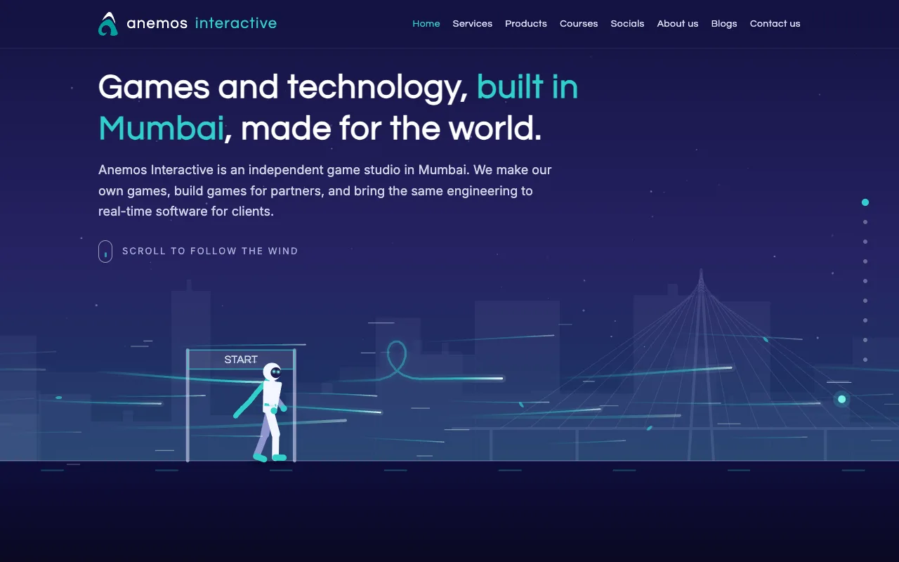
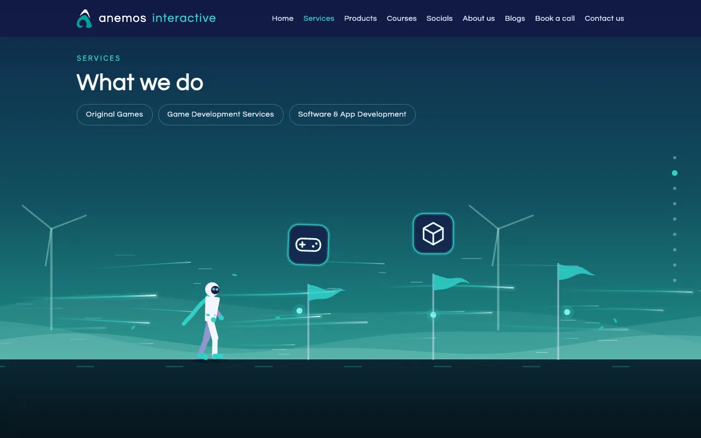
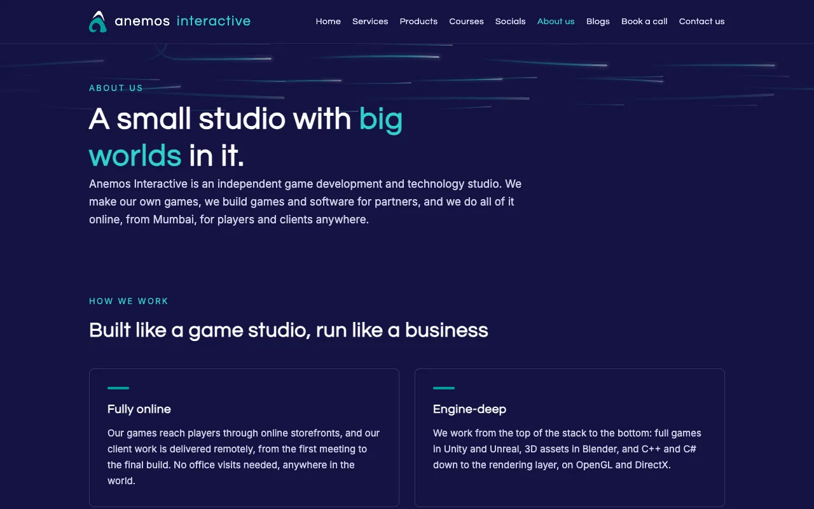
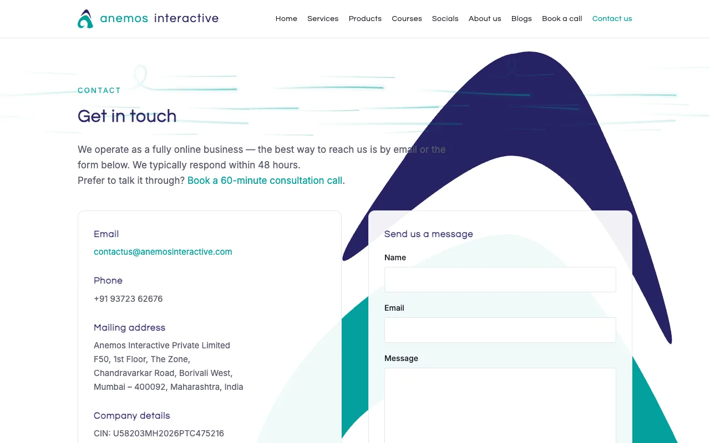
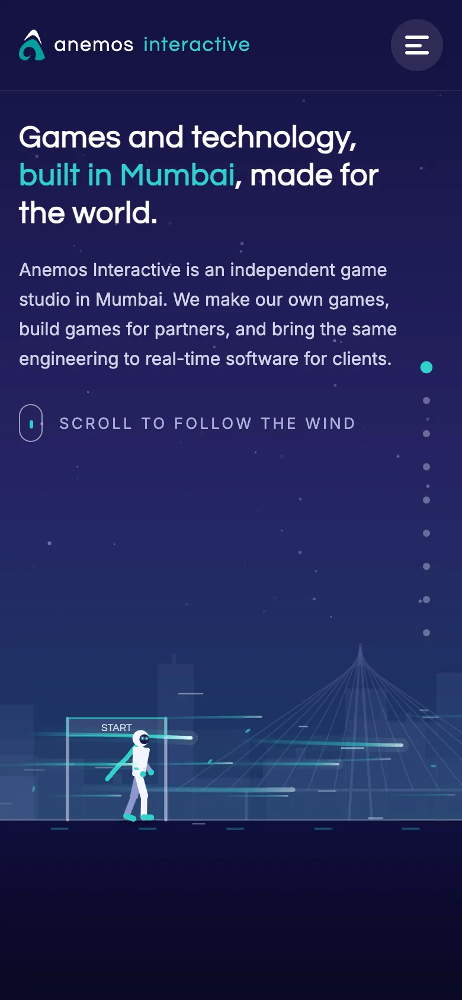

# Anemos Interactive — the website

This is the source of **[anemosinteractive.com](https://anemosinteractive.com)**, the website of Anemos Interactive Private Limited, a game and technology studio.



- [The idea](#the-idea)
- [How it came together](#how-it-came-together)
- [What's on the site](#whats-on-the-site)
- [How the run works](#how-the-run-works)
- [How the blog works](#how-the-blog-works)
- [Screens, browsers and speed](#screens-browsers-and-speed)
- [Search, sharing and analytics](#search-sharing-and-analytics)
- [The stack, and why](#the-stack-and-why)
- [The brainstorm, honestly](#the-brainstorm-honestly)
- [Hosting on Cloudflare](#hosting-on-cloudflare)
- [How it's built](#how-its-built)
- [Running it yourself](#running-it-yourself)
- [Folder map](#folder-map)
- [Credits](#credits)

## The idea

We didn't want a brochure. We make games, so the site should feel like one.

The home page is a single run. A runner stands at a start line; as you scroll, the wind pushes them along an obstacle course, and each stop on the course is a section of the site: what we do, the game we're building, courses, where to follow us, who we are. The copy for each stop blows in word by word as the runner reaches it. At the end of a section there's a hoop; run through it and the wind carries you to another page. Every page you land on arrives on the same gust, so the whole site feels like one place.



Everything on the course is drawn live: the runner, the wind lines, the hoops, the start gate, the windmills, the construction site, the social-media tiles the runner has to hop over. The words are ordinary HTML laid over the canvas, so search engines, screen readers and people with JavaScript off all get the full text.

## How it came together

It started as one line: *"a runner on an obstacle course, guided by wind, and the text appears as you scroll."* The first version was a stick figure on a flat line and a wall of text. From there it was mostly iteration and other people's eyes.

- **Pace.** The first run was far too quick — one flick of the wheel and you had skipped three sections. The scroll distance was stretched again and again (it ends up at roughly thirty-four screen heights of scrolling for one screen of picture) until it felt like walking through it. A column of dots on the right lets you jump to any stop or drag between them. We tried a "speed bump" that slowed the scroll when you rushed; it felt like fighting the page and was taken out.
- **Worlds.** Each section got its own weather and scenery so you know where you are without reading: a city skyline at the start, windmills for services, a building site for the game in progress, a lecture hall for courses, a sky full of gusts for socials.
- **Screens.** It had to work from a 4K monitor down to a 300-pixel-wide phone, folded and unfolded, upright and on its side. Sideways phones get a different layout: the copy sits on the left over a dark scrim and the run happens on the right.
- **Slow connections.** People in low-bandwidth areas told us the page jumped to the end before it had loaded. The fix was a loading screen that only appears when it is needed, waits until about 60% of the site (by weight) has arrived, and never shows on a return visit because everything is cached by then.
- **Browsers.** Checked in the Chromium, Firefox and WebKit engines, and against Samsung Internet, whose taller toolbars shorten the screen enough to hide things that Chrome shows.
- **Copy.** Friends and a few people in the industry read it and told us where it was vague, where it overclaimed and where it sounded like every other studio. "Technology consulting" became "software & app development" because that is what it is; a line about rendering layers was softened until it was true.
- **The small things people noticed.** The purple that looked off, the logo touching the edge on small phones, the social tiles that made the runner jump too often (now they alternate: hop one, duck under the next), the title on a blog post that didn't line up with the text below it. Most of what is good about the site came from someone saying "that looks wrong".


The timeline, roughly: a plain static site in late September 2026; the run, the worlds and the responsive work in the first ten days of October; live on 10 October; the loading screen, booking page, analytics and legal pages over the following two days; the blog and its admin after that.

## What's on the site

| Page | What it is |
|---|---|
| **Home** | The run: services, products, courses, socials, about, and a hoop into the contact page |
| **Products** | *It Still Beats*, our first game, and a construction worker waving from the site while it's built |
| **Blogs** | Posts from the team, written in a small admin of our own (see below) |
| **About us** | How we work and who the founders are |
| **Book a call** | A calendar for a free consultation call, shown in the visitor's local time, booked straight into our calendar |
| **Contact** | A form, email, phone and working hours, the socials you can message us on, and the mark from our business card behind the page |
| **Privacy, Terms** | Written for visitors in the EU, India and elsewhere, and kept in step with what the site actually collects |
| **Company details** | The legal name, registered office and registrations, linked from the footer of every page beside Privacy and Terms |
| **404** | "The wind took this page somewhere else" |




## How the run works

All of it lives in [`public/wind.js`](public/wind.js), with the layout in [`public/style.css`](public/style.css).

- The page is very tall and the stage is sticky, so scrolling doesn't move the picture; it moves the runner. Scroll position is converted into a distance along the course, measured in runner heights, and everything on the course is placed in those units. That is why it looks the same whether the screen is a phone or a cinema display: the world scales with the runner.
- Each section is a *panel* of HTML (heading, copy, buttons). The panel fades in as the runner approaches its stop, the words are split into spans and revealed one after another with a stagger, and the whole panel is scaled down on small screens so it never overlaps the course.
- Hoops sit at the end of sections. Reaching one plays a short wipe — the wind sweeps across the screen — and the next page opens with the same wipe clearing, using a flag in session storage so it knows it arrived on the wind.
- The social section's tiles are real links positioned over the canvas, so they are clickable, keyboard-reachable and drawn as obstacles at the same time.
- The dots on the right are the same stops. Click one to go there; drag along them to scrub through the run.
- If the visitor has asked their system for reduced motion, the run is switched off and the sections are shown as a plain page.

## How the blog works

The blog is the only dynamic part of the site. It runs in a Cloudflare Worker ([`src/`](src/)) next to the static pages — about 900 lines of JavaScript with one dependency (the Markdown parser).

**The stack for it, and why**

| Part | What we use | Why |
|---|---|---|
| Pages and API | A Cloudflare Worker (the same one that serves the site) | No server to run or patch; it scales to zero and runs next to the visitor. |
| Posts | Cloudflare D1 (SQLite at the edge) | A real relational database with plain SQL, free at this size, and it lives in the same account as everything else. |
| Images | Cloudflare R2 (object storage) | Ten gigabytes free and no charge for bandwidth, which is the cost that bites on image-heavy blogs elsewhere. |
| Writing | Markdown, parsed by `marked` | Plain text, portable, and simple to render safely. |
| Safety | Cloudflare's built-in HTML rewriter as an allow-list | Every tag and attribute a post can contain is on a short list; anything else is dropped before it reaches a page. |
| Sign-in | Cloudflare Access with Microsoft 365 (Entra ID) as the identity provider | Staff already have Microsoft accounts with multi-factor sign-in; we add nothing to manage, and a disabled account is locked out of the admin instantly. |
| Editor | A plain text box with a formatting bar, in vanilla JavaScript | Fast, no dependencies, and it does exactly what a blog needs and nothing more. |
| Fresh indexing | IndexNow | One request on publish tells Bing and the engines that share its index to recrawl. |


- **Posts** live in a Cloudflare D1 database ([`schema.sql`](schema.sql)): title, address, summary, Markdown, the rendered HTML, cover image, author, status and dates. Images go into an R2 bucket and are served from `/media/`.
- **Public pages:** `/blogs` (cards, newest first, twelve per page) and `/blogs/<address>` for each post, in the same style as the rest of the site, with a share image, structured data for search engines, an RSS feed at `/blogs/feed.xml`, and every published post added to `sitemap.xml` automatically. Posts without a cover get a panel with the studio mark so the grid stays even.
- **Admin:** on its own hostname, behind Cloudflare Access, linked from the footer of the blog pages. Only the team's Microsoft 365 accounts that are in the Blog Authors group can sign in; Access checks that at the door, and the Worker verifies the signed token and the group membership again on every request rather than trusting the gate alone. The author's name comes from their Microsoft account, so a rename there changes old posts too. The founder can edit anything; everyone else edits only their own posts.
- **Writing:** Markdown in a plain text box with a formatting bar (headings, bold, italic, underline, strikethrough, sub- and superscript, links, images, lists, checklists, quotes, code, tables, dividers), a live preview, and the list continuation you'd expect from an editor — Enter continues a list, a second Enter ends it. Images are shrunk in the browser before upload and shown at a consistent width in posts, whatever size they were.
- **Safety:** everything typed is rendered through an allow-list, so a post can never carry scripts or styles onto the site; uploads are checked by their first bytes rather than their name, limited to PNG, JPEG, WebP and GIF under 8 MB, and served as exactly that type; the editor's requests carry a header the API insists on; every create, publish, unpublish, delete and upload is recorded with who did it and when; each environment (live and test) has its own database and bucket.
- **Search engines:** publishing a post pings IndexNow, so Bing and the engines that share its index pick it up within hours.

## Screens, browsers and speed

- **Fourteen sizes** are checked on every change, from 3840×2160 down to 300×600, including tablets both ways, folding phones open and closed, and phones on their side.
- **Engines:** Chromium, Gecko (Firefox) and WebKit (Safari), plus Samsung Internet's screen sizes, user agent, dark mode and toolbar heights.
- **Layout shift is zero.** Fonts are served from the site itself and preloaded, the sections are hidden until the run is ready, and nothing moves after first paint.
- **Caching:** fonts and the brand set are cached for a year; the stylesheet and scripts for ten minutes. Every page's stylesheet and script URLs are stamped with a hash on every deploy, so a change shows on the next load without waiting for a cache to expire.

## Search, sharing and analytics

- Every page has its own title, description, canonical address, Open Graph and Twitter card, and the home page carries `Organization` structured data (founders, address, social profiles). Blog posts carry `BlogPosting` data.
- `sitemap.xml` lists every page and, through the Worker, every post. `robots.txt` keeps the 404 page and the admin out of search.
- Analytics is Google Analytics 4 behind a consent line. Until a visitor accepts, nothing is stored on their device; decline is remembered too. The privacy policy spells out exactly what is collected and for how long.

## The stack, and why

| Choice | Why |
|---|---|
| **Plain HTML, CSS and JavaScript** for the pages — no framework, no bundler | The site is nine pages and one big animation. A framework would add a build step, a dependency tree and kilobytes of runtime for no visible benefit, and plain files are the easiest thing to keep running for years. |
| **Canvas 2D** for the run, not WebGL or a game engine export | Canvas 2D works in every browser going back about eight years, needs no GPU features, and draws a few hundred lines and shapes per frame comfortably on a cheap phone. The whole run is one file. |
| **HTML for the words**, drawn over the canvas | Search engines, screen readers and visitors with JavaScript off all get the full copy. Nothing you can read on the site exists only as pixels. |
| **Two self-hosted fonts** (Questrial for headings, Inter for text), with Google Fonts as a fallback | Serving them from our own domain means no third-party request on first paint, no layout shift, and nothing for the privacy policy to explain unless the fallback is used. |
| **Cloudflare Workers** for hosting, **D1** for the blog's database, **R2** for images, **Access** for the admin sign-in | One provider, one deploy command, and all of it on free tiers (see below). |
| **Microsoft 365** for email, the booking calendar and staff identities | We already pay for it; it gives us bookings, calendars and multi-factor sign-in without building any of them. |
| **Web3Forms** for the contact form | A static site cannot receive a form post. Web3Forms delivers the message to our inbox with a honeypot against bots and no account for the visitor to make. |
| **Google Analytics 4** with Consent Mode | We wanted to know how many people visit, from where, on what devices, and which part of the run they use — without setting a cookie until someone agrees. |
| **Markdown** for blog posts | Plain text that any editor can open, easy to render safely, and it keeps authors writing instead of styling. |

## The brainstorm, honestly

Every "why" in the table above has a longer, less flattering story. Here they are, in the order we argued about them.

**"Should we use a framework?"** The first ten minutes of any website project. We listed what the site needed to do: show nine pages and make a small person run. React, Vue and friends are superb at managing state across hundreds of components; we had one component, and it was a canvas. We'd have spent a day setting up a build pipeline to ship a runtime larger than our entire site. So: no framework. The site is files in a folder. You can open it from your desktop. It's wonderful.

**"Canvas, WebGL, or just export a video?"** The video idea lasted until someone asked how you'd make a video responsive to fourteen screen sizes and a scroll wheel. WebGL was tempting — we're a game studio, it would have been on brand — but it means shaders, GPU quirks on cheap phones, and a blank rectangle on anything eight years old. Canvas 2D draws lines and circles. Our runner is lines and circles. Every browser since roughly the Obama administration can do it. Sold.

**"The text has to be real text."** This one wasn't a debate so much as a rule we had to keep re-learning. It is very easy, when you're drawing a world, to draw the words into it too. Then Google can't read them, screen readers can't read them, and the one visitor with JavaScript turned off gets a beautiful empty sky. Every word is HTML laid over the canvas. The canvas only ever draws things that don't need reading, like a sign that says START.

**"Fonts from Google, or our own?"** Google Fonts is the easy answer and it is one extra request to a third party on every first visit, which the privacy policy would then have to explain. We serve two font files from our own domain, preload them, and keep Google as a fallback for the day our copies go missing. Layout shift went to zero, which made us unreasonably happy.

**"Netlify was fine. Why did we move?"** It was fine. It also put a login wall in front of our preview link, which is a problem when the whole point of a preview link is sending it to someone. Meanwhile our domain's DNS was already at Cloudflare because that's where the Microsoft 365 mail records live. Cloudflare's Workers host static files for free, with no bandwidth charges and no login wall, and the deploy is one command. The move took an afternoon and we have not thought about hosting since, which is the highest compliment hosting can get.

**"How does a static site receive a form?"** It doesn't. That's what static means. Options were: write a backend (for one form), use a mail-sending API (and build the form handling ourselves), or use a service whose entire job is turning a form post into an email. Web3Forms does the last one, with a honeypot field that bots fill in and humans never see. Our inbox has been quiet in exactly the right way.

**"Booking calls: build or buy?"** We briefly sketched a calendar widget with time-zone handling. Then we remembered we pay for Microsoft 365, which includes Bookings, which already does time zones, buffers, confirmations and reminders, and puts the call straight in the calendar. The sketch was deleted with great dignity.

**"Analytics without being creepy."** We wanted numbers: visits, countries, devices, which part of the run people actually reach. We did not want a cookie set on anyone who hadn't agreed to it. Google Analytics 4 has a consent mode that sends anonymous, cookieless pings until someone says yes, and the full picture after. One short line at the bottom of the page asks. It is not a banner. We have strong feelings about banners.

**"The blog: WordPress? Ghost? A folder of Markdown files?"** WordPress would have meant a second server, PHP, plugins and a lifetime of updates for a blog that posts a few times a month. A folder of Markdown files in the repo would have meant a git commit every time Latika wanted to fix a typo. The middle path: posts in a small database at the edge (Cloudflare D1), images in a bucket next to it (R2, free bandwidth again), rendered by the same Worker that serves the site. There is nothing to patch. It costs nothing. It's about 900 lines, and we understand every one of them.

**"Who gets to post, and how do we know it's them?"** First plan: email one-time codes to anyone with an @anemosinteractive.com address. Reasonable, until we noticed we'd be building a login system — codes, expiry, rate limits, the lot — to prove something Microsoft already proves every morning when staff sign in to their email. So the admin sits behind Cloudflare Access with Microsoft 365 as the identity provider. Sign-in is your Microsoft password plus your second factor; the author name on a post is whatever your Microsoft account says. Disable someone's account and they're out of the blog too. We built nothing and got multi-factor authentication for free, which is the sort of trade you take.

**"Rich text editor or Markdown?"** Rich text editors are either enormous or buggy, and usually both. Markdown is a text box. We added a bar of buttons so nobody has to remember that two asterisks mean bold, taught the box to continue a list when you press Enter, and called it done. The posts are plain text that will open in anything, forever.

**"What about the giant image problem?"** The first test post had a 4000-pixel cover that took over the page, and a 200-pixel icon you needed a magnifying glass for. Now the editor shrinks big images before they upload and the page shows every image at the same width. Tiny images get scaled up and look a bit soft about it, which we've decided is a lesson rather than a bug.

**"How do search engines find a new post?"** Normally: whenever they get round to it. IndexNow is a one-line request that says "this address changed", and Bing and friends come within hours. It took five minutes to add. It will matter more than most of the things that took five days.

## Hosting on Cloudflare

The site started on Netlify with a GitHub Actions deploy. We moved to Cloudflare in October 2026 for three practical reasons: the domain's DNS was already at Cloudflare (it carries our Microsoft 365 mail records), Cloudflare's free tiers cover everything this site does, and there is no bandwidth bill — on most hosts a post that goes viral becomes an invoice; here it doesn't.

How it is laid out:

- **One Worker, two environments.** [`wrangler.jsonc`](wrangler.jsonc) describes `anemos-website` (live, on anemosinteractive.com and www) and `anemos-website-test` (test.anemosinteractive.com). Each has its own admin hostname, D1 database and R2 bucket, so nothing written on test can reach the live site. Deploying is `npx wrangler deploy --env <name>`; Cloudflare creates the DNS records and certificates for the hostnames itself.
- **Static assets first.** Everything in `public/` is uploaded as static assets and served from Cloudflare's edge without running any code — those requests are free and unlimited. The Worker only runs for the paths that need it: the blog, the images, the sitemap, and the HTML pages (so the admin hostname can refuse to serve them). Clean URLs come from the assets layer: `/about.html` is served at `/about`.
- **Caching** is set in [`public/_headers`](public/_headers): a year for fonts and the brand set, a week for logos and the share image, ten minutes for the stylesheet and scripts. Every page avoids even that wait: the Worker stamps the stylesheet and script URLs with a content hash on every deploy ([`scripts/stamp.mjs`](scripts/stamp.mjs)).
- **Limits that matter.** The Workers free plan allows 100,000 Worker requests a day — tens of thousands of page views; past that, Worker-served pages error rather than bill. D1's free tier is five million reads a day; R2's is ten gigabytes stored with no egress charge; Access is free for up to fifty users. If the blog ever needs more, the paid Workers plan is five dollars a month.
- **Branches match environments.** `main` is the live site, `test` is where the next release is built and checked. Nothing reaches `main` without passing the checks on `test` first.

## How it's built

- **Forms and bookings:** the contact form posts to Web3Forms with a honeypot against bots; the booking page embeds Microsoft Bookings, which shows free slots in the visitor's own time zone and books straight into our calendar.
- **Headers:** every response carries the standard protections (HTTPS only for a year, no content sniffing, no framing by other sites, a referrer policy) and a Content Security Policy that names the only places scripts, fonts and frames may come from: the site itself, Google Analytics, Cloudflare's beacon and Microsoft Bookings. The few scripts written inside the pages carry a nonce made fresh for each page view, so an injected script would not run. `/.well-known/security.txt` says where to report a problem.
- **Checks before anything goes out:** the resolution matrix, an interaction run (dots, drag, hoops, menu, socials, forms), HTML validation, an accessibility audit, Lighthouse, and the cross-engine run. Changes go to the test site first and to the live site only after all of that passes.



## Running it yourself

The static site needs nothing but a web server:

```sh
cd public && python3 -m http.server 8765
# open http://localhost:8765
```

The blog needs a Cloudflare account with a D1 database and an R2 bucket named as in `wrangler.jsonc`:

```sh
npm install
npx wrangler login
npx wrangler d1 execute anemos-blog-test --env test --remote --file=schema.sql   # once per database
npx wrangler dev --env test
```

Deploying is one command per environment: `npx wrangler deploy --env test`, or plain `npx wrangler deploy` for the live site. The admin's sign-in is configured per environment with `ACCESS_TEAM_DOMAIN`, `ACCESS_AUD` and `AUTHOR_GROUP` (the Microsoft group that may post) in `wrangler.jsonc`; until those are set, a `DEV_KEY` secret and a simple sign-in form stand in.

<p align="center"></p>

## Folder map

```
public/            the site as served: pages, style.css, wind.js, analytics.js, fonts, brand, sitemap, robots
public/admin.*     the blog admin's stylesheet and editor script
src/worker.js      entry point: public hostnames → the blog pages or static assets; admin hostname → the admin; security headers on every response
src/public.js      /blogs, posts, RSS feed, sitemap, images
src/admin.js       post list, editor, uploads, the JSON API the editor talks to
src/auth.js        Cloudflare Access token verification and the Blog Authors group check (and the stand-in sign-in for new environments)
src/markdown.js    Markdown → HTML with the allow-list sanitiser
src/db.js          the database queries
src/layout.js      the shared page shell: header, nav, footer, scripts
schema.sql         the blog's tables
scripts/stamp.mjs  runs before each deploy; stamps stylesheet and script URLs
wrangler.jsonc     hosting configuration for the two environments
docs/screenshots/  the images in this file
```

## Credits

Designed and built by **Ronak Koshy Jacob**, founder and managing director of Anemos Interactive. Brand and visual identity by **Latika Ganesh Salian**, co-founder and creative director. Thanks to the friends who scrolled too fast, read the copy twice and sent screenshots from phones we don't own.

© 2026 Anemos Interactive Private Limited. All rights reserved. The code is published so people can see how the site works; the Anemos Interactive name, logo, artwork, copy and *It Still Beats* are not licensed for reuse.
